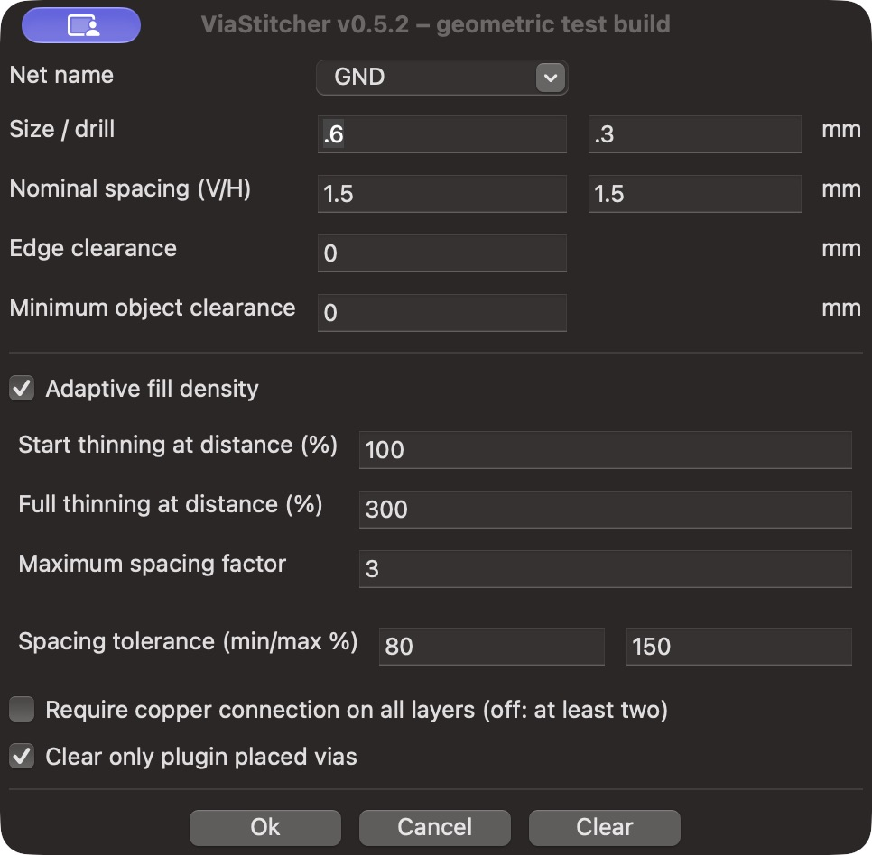

# ViaStitcher — new geometric placement engine + adaptive density

This experimental branch replaces the upstream grid/refill engine with a new
geometry-led engine. It is based on upstream master `d7eb10f`; the engine uses
KiCad's native integer polygon operations and Python's standard library.
The current build is tested with KiCad 10 on macOS.

Feature branch: [`feature/perimeter-placement`](https://github.com/RealHaltewunsch/viastitching/tree/feature/perimeter-placement).
See [adaptive density settings and validation](docs/adaptive-density.md) for the
new engine, controls, recorded PCB comparisons and limits. The current build
also enforces [global same-net minimum spacing](docs/global-spacing.md).



## Placement

Fill the copper zones in PCB Editor, select the intended zone and run
**Tools → External Plugins → ViaStitcher**. Set via diameter/drill and nominal
horizontal/vertical spacing. The plugin identifies permitted via-center areas,
processes the smallest areas first. Small or narrow regions start at an interior
center; larger regions follow nested contour fronts from their edges inward.
Blocked contour targets fall back to local geometric gap centers on preferred
nominal spacings.
The nominal spacing has no global board-grid phase. Remaining regions are
examined geometrically rather than by trying every point in a 0.01 mm raster.

All new positions use exactly 0.01 mm coordinates. Clearance geometry uses finer
native KiCad integer coordinates. Board edges, actual track/arc/pad/drill shapes,
via keepouts and the selected net's filled copper are checked geometrically.

- **Minimum spacing (%)** is a hard density minimum shared across all free
  regions, including every existing same-net via. Unequal X/Y values define an
  elliptical distance metric.
- **Maximum target spacing (%)** limits growth from a neighboring via. Obstacles
  can require a new independent seed; it does not guarantee that every nearest
  neighbor distance can satisfy an impossible target.
- **Edge clearance** keeps the full via body inside the board with this margin.
- **Minimum object clearance** defaults to zero, inheriting required board,
  netclass and supported project-rule clearances. It can add a stricter minimum.
- **Require copper connection on all layers (off: at least two)** retains its
  explicit explanation. Every new through via must fit selected-net copper on
  at least two enabled copper layers; enabling the checkbox requires all of them.

There is no separate **Refill islands and gaps** option: gap placement and final
remaining-area verification belong to the same engine. Old offset, style and
refill configuration keys are ignored; spacing, tolerances, zone/group ownership
and the explicit copper mode are preserved. Existing vias are never moved.

## Component pad protection

Stitching **drill disks must not overlap component pads**, including pads on the
same net, on any enabled copper layer traversed by the via. This is a permanent
placement rule in both uniform and adaptive modes. The actual pad contour is
expanded by the drill radius; checking only the drill center is insufficient.
Existing drilled-pad hole clearances and foreign-net copper clearances remain
in force. Existing vias are not automatically deleted.

Version 0.5.4 did not enforce this manufacturing policy: ordinary electrical DRC
allows same-net via-in-pad. Version **0.5.5** adds an explicit independent drill /
pad audit. See [pad protection validation](docs/pad-drill-protection.md).
For a clean rerun of an old build, use **Clear only plugin placed vias**, refill
the zones and generate again. User-placed vias are preserved.

## Adaptive fill density

The **Adaptive fill density** checkbox is optional and defaults to off. It uses
an immutable snapshot of actual track, arc and pad copper contours on **all
enabled copper layers and all nets**. Frozen permitted-area boundaries also
protect outer edges, holes and disconnected islands. Density uses the smaller
distance to track/pad copper or an area boundary, in normalized X/Y coordinates.
Zone interiors, via proximity, labels and mechanical component outlines are not
additional copper-proximity features. Generated same-net vias do not change the
frozen field. See [interior-only placement and validation](docs/interior-density.md).

- **Start thinning at distance (%)**: default **100%**, minimum **100%**. Up to
  this distance from copper **or an area edge**, the local nominal spacing remains unchanged.
- **Full thinning at distance (%)**: default **300%**, strictly greater than
  the start. The spacing factor increases linearly between these distances.
- **Maximum spacing factor**: default **3**, a positive integer. With 1.5 mm
  spacing, factor 3 gives a local target of 4.5 mm beyond the full distance.

The dense bands near area edges and pads are placed **before** the sparse
interior. This prevents sparse interior vias from consuming still-free dense
edge positions. Narrow regions with no sufficiently deep interior stay dense.

The minimum/maximum tolerance percentages apply to this **local** spacing. The
larger local factor of a candidate and an existing same-net via sets their pair
spacing, preventing dense gaps from being added beside sparse-area vias. Density
exclusion is shared across all free regions, including areas separated by a
track. Only the local growth direction, neighbor target and phase remain
independent. Remote vias outside the minimum-distance ellipse have no influence.
Physical drilled-hole constraints also remain global.
Existing vias are not moved or removed. The geometric gap search uses the same
field, so it cannot refill sparse areas to the old dense pitch. This new engine
has no fixed global raster and no separate refill pass; adaptive density scales
its preferred local spacing rather than thinning rows of the old grid engine.

The settings are saved per zone. Old configurations without the option remain
disabled; previous `SparseGrid` density settings are recognized. Non-finite
inputs, a start below 100%, an end at/below the start, non-integer factors and
coordinate-overflow dimensions are rejected before board changes. Geometry and
density preparation share the cancellable pulsing progress dialog.

This is a **geometric heuristic**, not a simulation or a statement about current
flow, return paths, RF behavior or whether a particular area needs stitching.

## Existing foreign copper

Foreign zone copper can refill around new vias. A blanket exclusion band around
foreign fills previously discarded valid gaps; version 0.5.4 replaces it with
checks of existing foreign-net pad/via connections. The minimum-width zone core,
fixed tracks/pads/vias and alternative paths across layers are considered.
Accepted holes are incorporated immediately. A split that only separates an
unanchored copper fragment is permitted; breaking an existing terminal connection
is rejected. Physical object clearances and via keepouts remain independent checks.

See [perimeter placement and gap regression validation](docs/perimeter-placement.md).
Earlier validation reports describe their historical releases; their claim of
complete coverage applied to a too-conservative permitted domain and did not
establish coverage of every actually usable PCB gap.

## Design rules

KiCad exposes native shape/clearance operations but does not expose its general
pairwise C++ DRC rule evaluator to SWIG plugins. This branch additionally reads
literal **clearance matrices** from the associated `.kicad_dru` file, with
conditions on `A/B.NetClass` and `A/B.NetName`, boolean combinations, and optional
layer restrictions. Project netclass assignments/patterns are read from the
associated `.kicad_pro`, including standalone validation runs.

This is not an implementation of arbitrary KiCad custom expressions. Unsupported
distance-rule conditions/dimensions, other custom distance-constraint types, or
explicit custom via/disallow constraints
stop processing before board changes with an explanatory message. When rules
relax preceding clearances, the stricter supported minimum is retained
conservatively. Run KiCad DRC after placing/refilling; actual project-rule checks
remain the final validation.

## Progress, cancellation and Clear

A pulsing progress dialog shows that copper geometry/placement is active. Cancel
stops the operation; already added vias are retained and the result is explicitly
marked incomplete. The existing plugin group is used for all generated vias.
**Clear only plugin placed vias** removes those vias and preserves manual ones.
Generated vias are marked free/net-bound so refilling does not reassign their net.

## Installation and development

Install the testing PCM ZIP with **Plugin and Content Manager → Install from
File**, then restart PCB Editor. The ZIP contains the engine and geometry/rule
adapters; no NumPy/SciPy/Shapely installation is needed for the plugin.

`viastitcher.fbp` is authoritative; regenerate `viastitcher_gui.py` with
wxFormBuilder. Compile language catalogs with `python3 locale_setup.py`.

```sh
python3 -m unittest discover -s tests -v
# Using KiCad's bundled Python (wx/pcbnew):
python3 tests/native_regressions.py
python3 tests/native_density.py
```

Independent verification uses an isolated test environment with Shapely/SciPy;
these libraries are not included in or required by the plugin.

## Algorithm references

The new code was written independently. Native free-space subtraction follows
KiCad's polygon/clearance model:
[KiCad 10 zone filler](https://gitlab.com/kicad/code/kicad/-/raw/10.0/pcbnew/zone_filler.cpp).
Minimum-distance coverage is related to
[maximal Poisson-disk sampling](https://doi.org/10.1145/2010324.1964944) and
[geometric gap processing](https://arxiv.org/abs/1211.3297).

Upstream project and original authors: [weirdgyn/viastitcher](https://github.com/weirdgyn/viastitcher).
