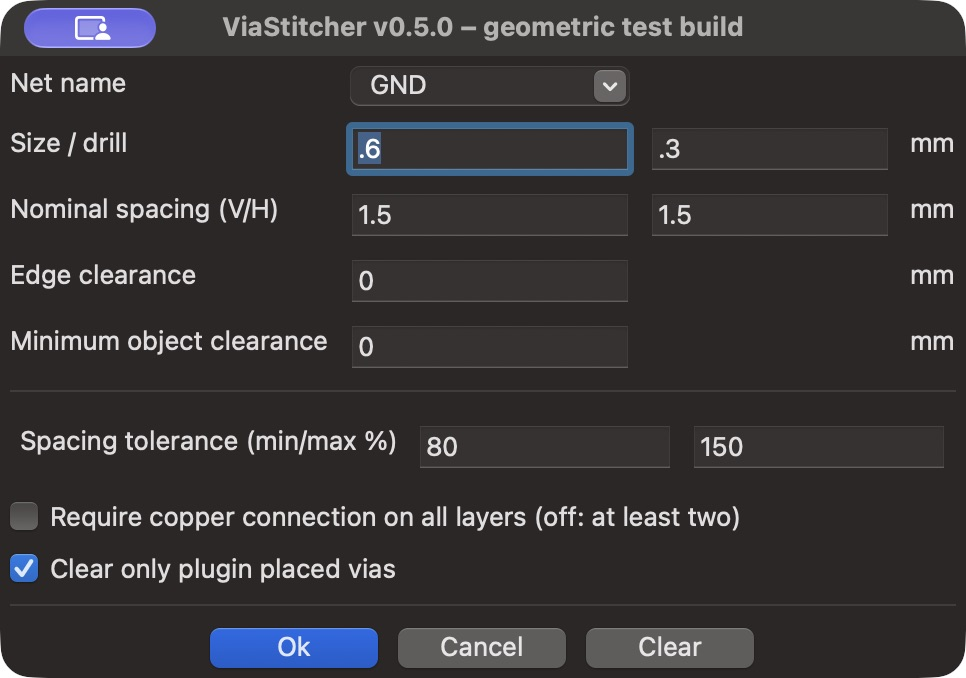

# ViaStitcher — geometric placement test build

This experimental branch replaces the upstream grid/refill engine with a new
geometry-led engine. It is based on upstream master `d7eb10f`; the engine uses
KiCad's native integer polygon operations and Python's standard library.
The current build is tested with KiCad 10 on macOS.



## Placement

Fill the copper zones in PCB Editor, select the intended zone and run
**Tools → External Plugins → ViaStitcher**. Set via diameter/drill and nominal
horizontal/vertical spacing. The plugin identifies permitted via-center areas,
starts in the middle of available gaps and grows on preferred nominal spacings.
The nominal spacing has no global board-grid phase. Remaining regions are
examined geometrically rather than by trying every point in a 0.01 mm raster.

All new positions use exactly 0.01 mm coordinates. Clearance geometry uses finer
native KiCad integer coordinates. Board edges, actual track/arc/pad/drill shapes,
via keepouts and the selected net's filled copper are checked geometrically.

- **Minimum spacing (%)** is a hard density minimum within an independent free
  region, including existing same-net vias. Unequal X/Y values define an
  elliptical distance metric.
- **Maximum target spacing (%)** limits growth from a neighboring via. Obstacles
  can require a new independent seed; it does not guarantee that every nearest
  neighbor distance can satisfy an impossible target.
- **Edge clearance** keeps the full via body inside the board with this margin.
- **Minimum object clearance** defaults to zero, inheriting required board,
  netclass and supported project-rule clearances. It can add a stricter minimum.
- **Require copper connection on all layers (off: at least two)** retains its
  explicit explanation. Every new through via must fit selected-net copper on
  at least two enabled copper layers; enabling the checkbox requires all of them.

There is no separate **Refill islands and gaps** option: gap placement and final
remaining-area verification belong to the same engine. Old offset, style and
refill configuration keys are ignored; spacing, tolerances, zone/group ownership
and the explicit copper mode are preserved. Existing vias are never moved.

## Existing foreign copper

The engine protects the boundary and narrow-neck bands of foreign filled zones.
A clearance hole fully inside a sufficiently broad foreign plane remains allowed
when at least two other layers provide the selected net. A minimum physical
spacing between new hole envelopes keeps those holes from forming a cut through
that plane. This can impose more separation than a very small nominal pitch.
These protections preserve existing copper rather than relying on a later fill
silently cutting a narrow connection to another net.

## Design rules

KiCad exposes native shape/clearance operations but does not expose its general
pairwise C++ DRC rule evaluator to SWIG plugins. This branch additionally reads
literal **clearance matrices** from the associated `.kicad_dru` file, with
conditions on `A/B.NetClass` and `A/B.NetName`, boolean combinations, and optional
layer restrictions. Project netclass assignments/patterns are read from the
associated `.kicad_pro`, including standalone validation runs.

This is not an implementation of arbitrary KiCad custom expressions. Unsupported
distance-rule conditions/dimensions, other custom distance-constraint types, or
explicit custom via/disallow constraints
stop processing before board changes with an explanatory message. When rules
relax preceding clearances, the stricter supported minimum is retained
conservatively. Run KiCad DRC after placing/refilling; actual project-rule checks
remain the final validation.

## Progress, cancellation and Clear

A pulsing progress dialog shows that copper geometry/placement is active. Cancel
stops the operation; already added vias are retained and the result is explicitly
marked incomplete. The existing plugin group is used for all generated vias.
**Clear only plugin placed vias** removes those vias and preserves manual ones.
Generated vias are marked free/net-bound so refilling does not reassign their net.

## Installation and development

Install the testing PCM ZIP with **Plugin and Content Manager → Install from
File**, then restart PCB Editor. The ZIP contains the engine and geometry/rule
adapters; no NumPy/SciPy/Shapely installation is needed for the plugin.

`viastitcher.fbp` is authoritative; regenerate `viastitcher_gui.py` with
wxFormBuilder. Compile language catalogs with `python3 locale_setup.py`.

```sh
python3 -m unittest discover -s tests -v
# Using KiCad's bundled Python (wx/pcbnew):
python3 tests/native_regressions.py
```

Independent verification uses an isolated test environment with Shapely/SciPy;
these libraries are not included in or required by the plugin.

## Algorithm references

The new code was written independently. Native free-space subtraction follows
KiCad's polygon/clearance model:
[KiCad 10 zone filler](https://gitlab.com/kicad/code/kicad/-/raw/10.0/pcbnew/zone_filler.cpp).
Minimum-distance coverage is related to
[maximal Poisson-disk sampling](https://doi.org/10.1145/2010324.1964944) and
[geometric gap processing](https://arxiv.org/abs/1211.3297).

Upstream project and original authors: [weirdgyn/viastitcher](https://github.com/weirdgyn/viastitcher).
