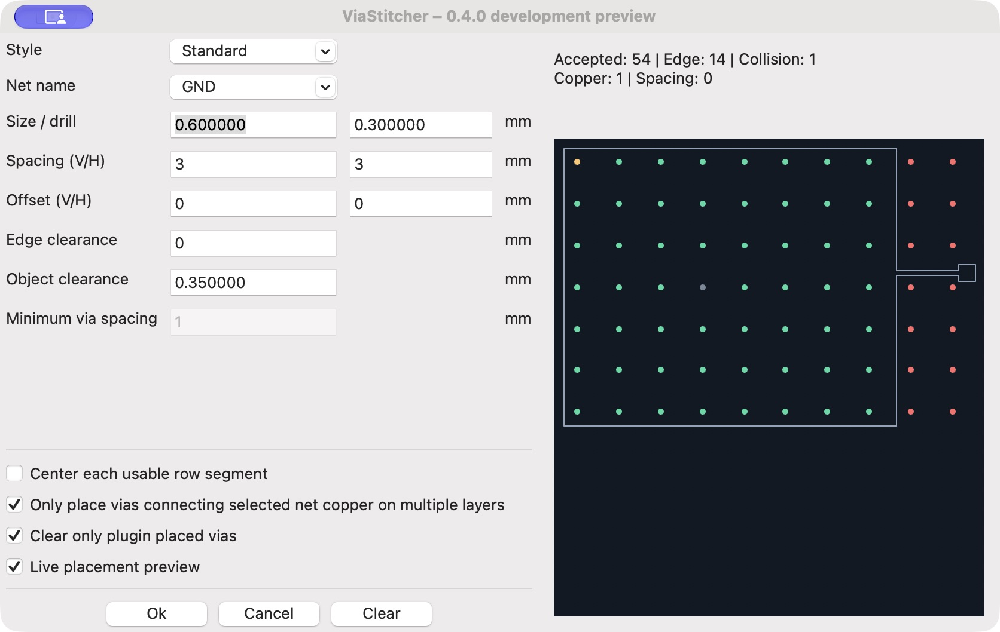

# User Interface

The dialog uses the active KiCad unit (millimeters or mils). Numerical values
must be finite. Incomplete input disables preview calculation until corrected.
Invalid placement input is rejected before configuration or board changes.

| Control | Meaning |
| --- | --- |
| Style | Standard, Stagger, Randomize, Spiral or Maximize. |
| Net name | Net assigned to newly generated vias; initially the selected zone's net. |
| Size / drill | Copper diameter and hole diameter. Both must be positive; drill must be smaller than diameter. Initial values come from Board Setup. |
| Spacing (V/H) | Vertical/horizontal center spacing. Must be positive. Used by grid modes and as the vertical/horizontal scale for Spiral. |
| Offset (V/H) | Global grid phase. May be negative. Not used by Spiral or Maximize. |
| Edge clearance | Additional distance from the via's outer edge to zone and board boundaries. Default 0. Zero still keeps the complete via inside. |
| Object clearance | Additional margin from conflicting pads, tracks, arcs and vias. Default 0.35 mm (converted to mils when needed). Zero does not disable overlap checks. |
| Minimum via spacing | Minimum center distance for Maximize. Independent of the Grid spacing fields; enabled only for Maximize. |
| Center each usable row segment | Re-centers each usable portion of a grid row. Enabled only for Standard and Stagger. Replaces horizontal phase/staggering; keeps vertical spacing and vertical offset. |
| Filled copper option | When enabled, the via footprint must connect filled copper of the selected net on every selected zone layer. When disabled, the center must lie in the selected zone's filled area on at least one layer. Boundary checks remain active. |
| Clear only plugin placed vias | Restricts Clear to the selected zone's plugin group. Enabled initially. |
| Live placement preview | Computes the same candidates and checks as placement without altering the board. Disabled initially. |

## Preview

The outline shows the selected zone. Green points are accepted, red points are
rejected by boundaries, yellow by collisions, gray by filled-copper requirements,
and purple by spacing. Counts report each category. For more than 20,000
candidates, drawing is limited and the caption says so; calculation and actual
placement still evaluate the complete candidate sequence.

The calculation is incremental and can be interrupted by changing a parameter
or disabling the preview. A failure in preview does not disable placement.
Randomize uses a session seed, so preview and placement agree until the dialog
is reopened. Changing board geometry outside the dialog requires recomputing the
preview; the preview is not a substitute for DRC.

## Clearance limitations

The plugin uses its geometry checks and the board's minimum hole-to-hole
setting when exposed by KiCad. It does not implement KiCad's complete custom
rule evaluator. Increasing either clearance may remove placements; it must not
add new positions to a fixed grid. Same-net track connections are allowed;
pads remain collision obstacles, matching the established plugin workflow.
